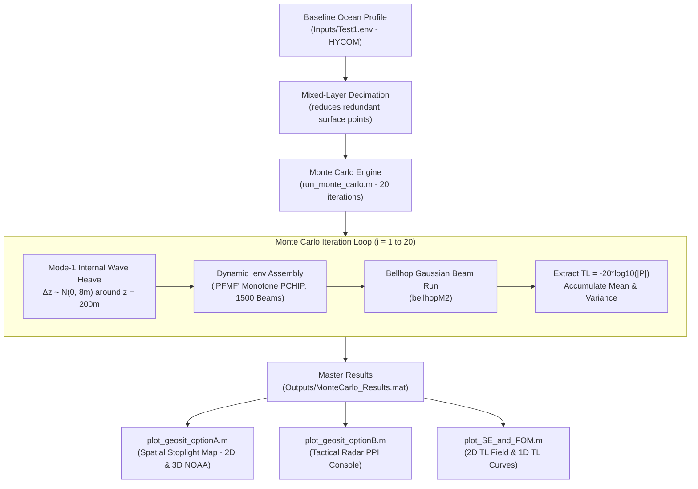

# Bellhop Acoustic Modeling & Monte Carlo Uncertainty Pipeline
A MATLAB-based underwater acoustics pipeline built on the **Bellhop Gaussian Beam ray tracer**. This system models ocean sound propagation, calculates environmental uncertainty caused by thermocline displacement, and provides top-down geographic situation (GeoSit) displays.
---
## Architecture & Workflow

---
## Detailed Breakdown of `run_monte_carlo.m`
The core simulation script is [`run_monte_carlo.m`](run_monte_carlo.m). Below is a section-by-section breakdown of the implementation:
### 1. Input Parsing & Setup (Lines 45–96)
* **Default Settings:** $N_{\text{mc}} = 20$ iterations, $N_{\text{beams}} = 1,500$ Gaussian beams.
* **Grid Resolution:** Sets vertical resolution to **300 depth cells** ($\sim 10\text{ m}$ spacing) and horizontal resolution to **500 range cells** ($80\text{ m}$ spacing out to $40\text{ km}$).
* **Target Depth:** Defaults to $100\text{ m}$ receiver depth for 1D line evaluation.
### 2. Reading Baseline Ocean Profile (Lines 98–126)
* Reads `Inputs/Test1.env` (retrieved from the HYCOM North Atlantic database).
* Extracts the sound speed profile (SSP) table: depth $z$ ($0$ to $3,013\text{ m}$) and sound speed $c$ ($1,486.15$ to $1,522.14\text{ m/s}$).
### 3. Mixed-Layer Decimation (Lines 128–163)
* **Context:** The raw HYCOM profile contains 35 depth points in the top 40 meters spaced $0.72\text{ m}$ apart. Because sound speed is nearly constant in this surface mixed layer ($dc < 0.05\text{ m/s}$), Bellhop's adaptive step-size algorithm (`reducestep.m`) reduced integration steps to very small intervals, taking ~5 hours for 20 runs.
* **Decimation:** Redundant points in the flat surface layer are decimated to $\sim 10\text{ m}$ spacing while preserving all points in the thermocline and deep ocean.
* **Result:** Maintains identical transmission loss results while reducing runtime from ~5 hours to ~8–12 minutes.
### 4. Thermocline Heave Perturbation Model (Lines 202–215)
* **Point-by-point noise:** Adding uncorrelated random noise ($\pm 1\text{ m/s}$) to each depth point creates artificial micro-gradients that scatter sound rays by up to $50\text{ dB}$.
* **Internal Wave Model:** Internal waves displace the seasonal thermocline vertically as a continuous physical layer. The script applies a Mode-1 internal wave displacement profile:
  $$\eta(z) = \Delta z_{\text{max}} \cdot \left(\frac{z}{z_{\text{core}}}\right) \exp\left(1 - \frac{z}{z_{\text{core}}}\right)$$
  * $\Delta z_{\text{max}} \sim \mathcal{N}(0, 8\text{ m})$ (Vertical heave standard deviation).
  * $z_{\text{core}} = 200\text{ m}$ (Depth of maximum displacement).
  * $\Delta c_{\text{bulk}} \sim \mathcal{N}(0, 0.2\text{ m/s})$ (Bulk water column offset).
* **Result:** Moves the thermocline vertically while preserving physical sound speed gradients and ducting.
### 5. Dynamic `.env` Generation (Lines 216–256)
On each iteration $i = 1 \dots 20$:
* Sets interpolation mode to `'PFMF'` (Monotone PCHIP ACS), avoiding cubic spline overshoot ripples.
* Sets beam count to 1,500 to ensure adequate ray coverage across shadow zones.
* Copies `.bty` (bathymetry), `.sbp` (beam pattern), and `.trc` (surface reflection coefficient).
* Writes temporary execution files: `Test_MC_i.env` and `Test_MC_i.ssp`.
### 6. Bellhop Execution & Accumulation (Lines 257–281)
* Executes `bellhopM2(indir, outdir, mc_name)`.
* Reads acoustic complex pressure $P(z, r)$ from `Test_MC_i.shd.mat`.
* Converts pressure to Transmission Loss (TL in dB):
  $$TL = -20 \log_{10}|P|$$
* Slices TL at the target depth ($100\text{ m}$) and accumulates the full 2D grid into `TL_full_sum`.
### 7. Automated Cleanup & Master Save (Lines 283–308)
* Deletes temporary `Test_MC_i.*` files after each run.
* Computes ensemble mean transmission loss:
  $$TL_{\text{mean}} = \frac{1}{N_{\text{mc}}} \sum_{i=1}^{N_{\text{mc}}} TL_i$$
* Saves master dataset to **`Outputs/MonteCarlo_Results.mat`**.
### 8. Automated Visualization Launch (Lines 310–314)
* Automatically launches the visualization displays upon completion.
---
## Visualization Displays
### Option A: Spatial Stoplight Map ([`plot_geosit_optionA.m`](plot_geosit_optionA.m))
* **Format:** Top-down circular $360^\circ$ radar scope displaying continuous Green ($\ge 70\%$), Yellow ($30\%\text{--}70\%$), and Red ($< 30\%$) probability of detection ($P_d$).
* **Dual Modes:**
  * **2D Symmetric Benchmark:** Concentric rings based on range-independent propagation.
  * **3D Real NOAA Bathymetry:** Uses real ETOPO 2022 bathymetry of the Cape Hatteras slope ($37.0^\circ\text{N},\; 74.2^\circ\text{W}$). Displays the deep ocean sound channel to the South/East ($> 25\text{ km}$ reach) and the shallow continental shelf cutoff to the North/West ($< 15\text{ km}$).
* **Interactive Controls:** Toggle buttons for 2D vs. 3D mode, and depth buttons for `[20 m]`, `[50 m]`, `[100 m]`, `[200 m]`, and `[500 m]`.
* **Directional Profile:** Compares North ($000^\circ$ shelf cutoff) vs South ($180^\circ$ deep channel) in a 1D line plot.
### Option B: Tactical Combat Console ([`plot_geosit_optionB.m`](plot_geosit_optionB.m))
* **Format:** Dark tactical radar PPI display with ownship glyph, full-field acoustic uncertainty heatmap, and circular directional degrees axis (000° to 350° azimuth compass bezel around the radar screen).
* **Circular Directional Degrees Axis:**
  * **Azimuth Compass Dial:** 360° circular bezel framing the radar scope with nautical degree tick marks every 10° and major bearing ticks every 30°.
  * **Directional Labels:** Prominent tactical azimuth readouts (`000° N`, `030°`, `060°`, `090° E`, `120°`, `150°`, `180° S`, `210°`, `240°`, `270° W`, `300°`, `330°`).
* **Full-Field 3-Color Acoustic Uncertainty System (Cyany Green, Yellow, Red ONLY):**
  * **Strictly 3-Color Visual Simplicity:** Employs strictly three colors: **Tactical Cyany Green** (`[0.08, 0.82, 0.60]`), **Vibrant Yellow** (`[0.98, 0.85, 0.12]`), and **Hot Red** (`[0.95, 0.20, 0.20]`). Zero extra hues (no blue, orange, or purple).
  * **Uniform Low-Threshold Baseline:** All spread values below $4.5\text{ dB}$ are rendered in the exact same solid Cyany Green for clean visual simplicity.
  * **Smooth 3-Color Gradient:** Transitions cleanly from Cyany Green $\to$ Yellow ($4.5\text{--}7.5\text{ dB}$) $\to$ Red ($> 7.5\text{ dB}$, peak internal wave volatility).
  * **Dynamic Colorbar Gradient Tracker:** A dedicated vertical colorbar includes an interactive **horizontal black indicator line with a pointer tag** that slides dynamically along the gradient to show the exact spread dB value of the hovered or pinned range.
* **Radar Range Distance Markers (Cross-Ticks at 10, 20, 30 km):**
  * Clean cardinal cross-ticks along North, East, South, and West axes without drawing distracting concentric circles.
  * Distance scale readouts (`10 km`, `20 km`, `30 km`) placed along the East ($090^\circ$) spoke with translucent dark backing.
* **Dynamic Black Highlighting Ring with Distance Caption:**
  * **Tactical Black Ring:** Pure bold black ring (`LineWidth = 2.8`) tracking cursor range during hover and lock.
  * **Following Distance Caption:** Sleek dark callout box directly following the ring at the cursor bearing, showing the exact distance (e.g. `14.2 km`) with an accent border matching the active zone color (`Cyany Green`, `Yellow`, or `Red`).
* **High-Visibility White Highlight Lines (1D TL & Probability Plots):**
  * Pure brilliant white (`[1.0, 1.0, 1.0]`), bold vertical cursor lines (`LineWidth = 2.5`) with `uistack` priority over all plot elements.
* **Grayscale 1D TL & Probability Plots:**
  * **1D Transmission Loss:** Grayscale axes and gridlines with all 20 individual Monte Carlo runs rendered in crisp medium-gray (`LineWidth = 1.2`) and the ensemble mean curve emphasized in Cyan (`LineWidth = 2.4`).
  * **Detection Probability ($P_d$):** Tactical area fill rendered in clean grayscale (`FaceAlpha = 0.35`) with 50% threshold reference line.
* **Color-Matched Tactical Inspector Box:**
  * **Dynamic Accent:** Box border, range heading, detection status, and tactical action dynamically color-matched to the active zone (`Cyany Green`, `Yellow`, or `Red`).
  * **Enlarged Typography:** 11 pt Consolas font for immediate legibility in operational settings.
* **One-Click Real-Time Sensor Depth Selector:** Simple tactical buttons `[20 m]`, `[50 m]`, `[100 m]`, `[200 m]`, and `[500 m]` without distracting labels; clicking any depth instantly switches the radar uncertainty heatmap, the 20 Monte Carlo curves, the mean TL curve, the FOM cutoff, and the $P_d$ curve in real time with zero latency.
* **Live Hover & Click Inspector:** Hovering or clicking on the scope displays bulleted tactical feedback:
  * **Detection Status:** Detection probability ($P_d$) and margin relative to FOM.
  * **20-Run TL Spread:** $\Delta TL = \text{Max} - \text{Min}$ along with individual min and max values.
  * **Statistical Metrics:** Interquartile Range ($IQR = Q_3 - Q_1$) and standard deviation ($\sigma$).
  * **Tactical Action:** Actionable recommendation (e.g. *"TEST TARGET WITH ACTIVE BEAM"* in high-spread zones vs *"MAINTAIN PASSIVE TRACK"* in steady zones).
### Statistical Uncertainty Diagnostics ([`plot_spread_distribution.m`](plot_spread_distribution.m))
* **Multi-Depth Uncertainty Comparison Dashboard:** Analyzes and visualizes the empirical Transmission Loss spread ($\Delta TL$) across all 5 operational sensor depths (`20m`, `50m`, `100m`, `200m`, `500m`).
* **Active Depth Histogram:** Binned distribution colored in strict 3-color scheme (Cyany Green $\le 4.5\text{ dB}$, Yellow $4.5\text{--}7.5\text{ dB}$, Red $> 7.5\text{ dB}$) with 33% Tertile, Median, and 66% Tertile markers.
* **Cumulative Distribution Comparison (CDF):** Overlays all 5 depth curves on a single plot, visually demonstrating why shallow duct (50m) produces high yellow/red volatility while dipping (200m) and deep (500m) sensors remain predominantly green.
* **Exact GeoSit B Matched Styling:** Dark obsidian background with grayscale axes and grids, pure 3-color histogram bars (Cyany Green, Yellow, Red), and Cyan active depth highlight.
* **Interactive Depth Buttons:** Simple header buttons `[20 m]`, `[50 m]`, `[100 m]`, `[200 m]`, `[500 m]` to toggle the active depth histogram and highlight in real time.
### Acoustic Physics Analysis: 2D Field & TL Curves ([`plot_SE_and_FOM.m`](plot_SE_and_FOM.m))
* Displays the 2D depth-range Transmission Loss Field (matching NUWC benchmark `plot_TL2.m`) and 1D Monte Carlo TL uncertainty curves with the $FOM = 104\text{ dB}$ detection threshold.
---
## Quick Reference / Usage
### Run Monte Carlo Simulation:
```matlab
run_monte_carlo                            % Test1, 20 runs, 1500 beams, optimized (~8-12 min)
run_monte_carlo(20, 1500, 'Test1', true)   % Explicit optimized call
run_monte_carlo(20, 1500, 'Test2')         % Test2 (Munk canonical profile)
```
### Launch Displays & Web Export:
```matlab
plot_geosit_optionB          % Option B (Tactical Radar Console in MATLAB)
export_geosit_to_html        % Export to standalone interactive HTML5 web console
plot_geosit_optionA          % Option A (Spatial Stoplight Map)
plot_geosit_optionA([], 200) % Option A starting at 200m depth
plot_spread_distribution     % Diagnostic Histogram & Threshold Optimizer
plot_SE_and_FOM              % 2D Signal Excess & FOM Analysis
```

> **Web Application:** Double-click [`Outputs/GeoSit_Tactical_Console.html`](Outputs/GeoSit_Tactical_Console.html) in Windows Explorer to run the complete interactive Tactical Radar Console offline in Chrome, Edge, Safari, or Firefox without requiring MATLAB installed.

---
## Outputs Generated
All artifacts are saved in the `Outputs/` folder:
* `Outputs/GeoSit_Tactical_Console.html`: **Standalone HTML5 Tactical Web Application** with interactive Sonar PPI Radar Canvas, synchronized 1D plots, 5-depth switching, and live attribution inspector (zero server/license dependencies).
* `Outputs/MonteCarlo_Results.mat`: Full numerical dataset (TL ensemble, grid coordinates, perturbed profiles).
* `Outputs/NOAA_Bathymetry_Polar.mat`: Polar bathymetric grid extracted from NOAA ETOPO 2022.
* `Outputs/Spatial_Stoplight_OptionA.png`: High-resolution export of Option A.
* `Outputs/Tactical_Combat_Display.png`: High-resolution export of Option B.
* `Outputs/Transmission_Loss_2D_Field.png`: Full-field 2D Transmission Loss range-depth map (matching NUWC `plot_TL2.m`).
* `Outputs/Transmission_Loss_Curves.png`: 100m depth Monte Carlo Transmission Loss curves and FOM threshold line.
