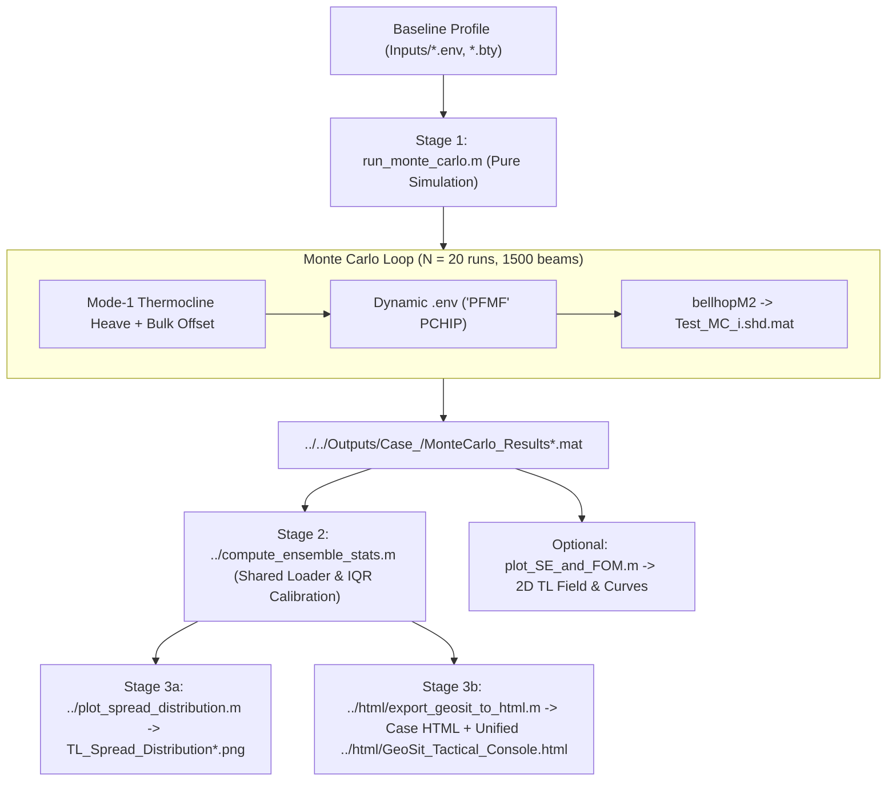

# Bellhop Monte Carlo & Post-Processing Pipeline

This directory houses the core **Bellhop Gaussian Beam Monte Carlo** physics simulation driver ([`run_monte_carlo.m`](run_monte_carlo.m)) and acoustic foundation plotter ([`plot_SE_and_FOM.m`](plot_SE_and_FOM.m)). See the root [`../../README.md`](../../README.md) for the full repository guide.

---

## Architecture & Workflow

Physics simulation is strictly separate from IQR calibration and displays, orchestrated by [`../run_workflow.m`](../run_workflow.m):



---

## Core Files
* [`run_monte_carlo.m`](run_monte_carlo.m):
  * Runs $N_{\text{mc}} = 20$ perturbed Bellhop simulations with $N_{\text{beams}} = 1,500$, `PFMF` monotone PCHIP interpolation, `300 x 500` range-depth grid (`40 km` / `43.7 kyd`), and mixed-layer SSP decimation (`Test1`/`Test3`).
  * Applies holistic Mode-1 thermocline heave ($\Delta z_{\text{max}} \sim \mathcal{N}(0, 8\text{ m})$ centered at $z_{\text{core}} = 200\text{ m}$) plus bulk offset ($\Delta c_{\text{bulk}} \sim \mathcal{N}(0, 0.2\text{ m/s})$).
  * Saves `Outputs/Case_<N>/MonteCarlo_Results*.mat` (including `source_depth_m`) and `Test_MC_*.shd.mat`, then prints the next `run_workflow` display command without running post-processing inline.
* [`plot_SE_and_FOM.m`](plot_SE_and_FOM.m):
  * Exports 2D Transmission Loss range-depth field (`Transmission_Loss_2D_Field*.png`) and 1D MC curves against `FOM = 104 dB` (`Transmission_Loss_Curves*.png`) directly inside the active case folder.
* [`../compute_ensemble_stats.m`](../compute_ensemble_stats.m):
  * Single shared loader across all modeled target depths (`33–3,306 ft`); cleans `r ~ 0` infinities and computes the empirical all-depth IQR boxplot thresholds (`Q1`, `Q3`, Tukey upper whisker, and `p99` full-red cap) consumed identically by [`../plot_spread_distribution.m`](../plot_spread_distribution.m) and [`../html/export_geosit_to_html.m`](../html/export_geosit_to_html.m).

> **Note on Legacy Plots:** Older MATLAB GeoSit GUI scripts and legacy outputs are archived in [`../../Other/legacy/`](../../Other/legacy). The interactive Tactical Console is now HTML-only ([`../html/GeoSit_Tactical_Console.html`](../html/GeoSit_Tactical_Console.html)).

---

## Quick Commands (Run from Repository Root or `MVP/`)

```matlab
% Rebuild adaptive IQR plot & HTML console from existing simulation (~5 sec)
addpath('MVP');
run_workflow('display');

% Also regenerate SE/FOM 2D & 1D PNG figures
run_workflow('all_displays');

% Run new Monte Carlo simulation first (e.g., Test3 with 100m sensor depth), then rebuild everything
run_workflow('full', 'Test3', 20, 1500);

% Or run pure physics simulation standalone:
run_monte_carlo(20, 1500, 'Test1');
```
