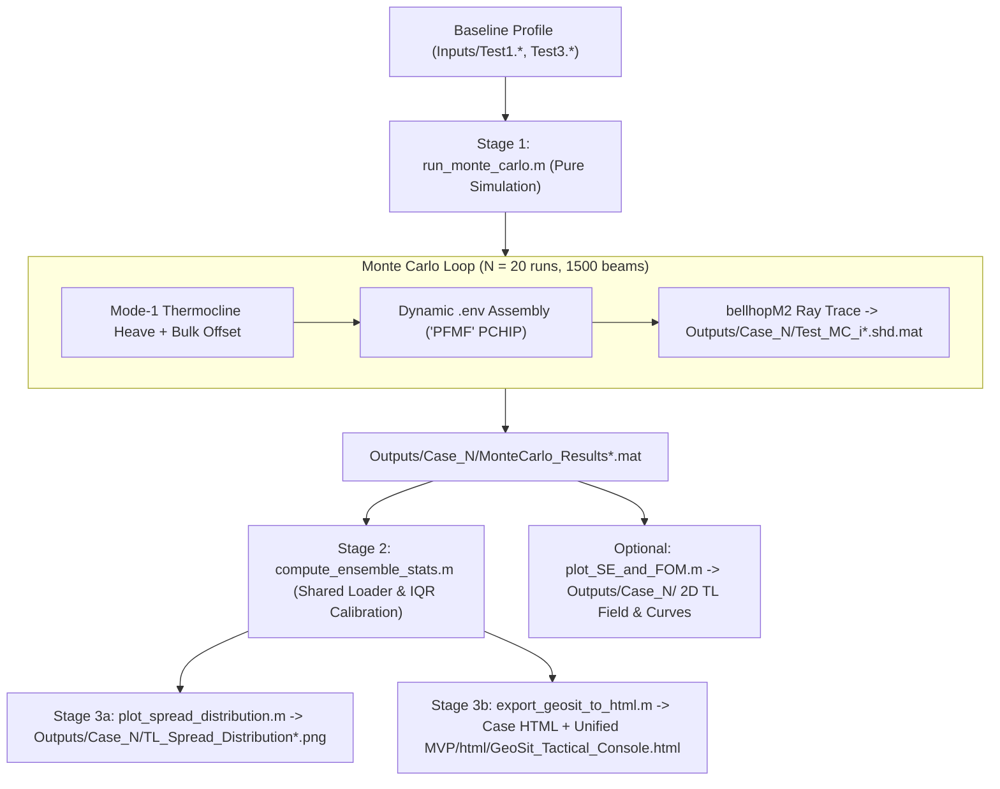

# Bellhop Acoustic Modeling & Monte Carlo Uncertainty Pipeline

A MATLAB + HTML5 underwater acoustics pipeline built on the **Bellhop Gaussian Beam ray tracer**. It models ocean sound propagation, quantifies environmental transmission loss uncertainty from internal-wave thermocline heave, calibrates adaptive IQR color scales across all modeled target depths, and exports an interactive standalone **GeoSit Tactical Console**.

---

## Architecture & 3-Stage Workflow

Physics simulation is decoupled from statistical post-processing and visualization behind one entry point, [`MVP/run_workflow.m`](MVP/run_workflow.m), so changing plot or color settings never forces a multi-minute Bellhop rerun.



### Repository Structure
* [`MVP/run_workflow.m`](MVP/run_workflow.m): Top-level pipeline runner (`display`, `all_displays`, and `full` modes) supporting single or paired sensor-depth cases.
* [`MVP/monte_carlo/run_monte_carlo.m`](MVP/monte_carlo/run_monte_carlo.m): Stage 1 Monte Carlo Bellhop driver (simulation only; writes `.mat` and `.shd.mat` outputs into `Outputs/Case_<N>/`).
* [`MVP/compute_ensemble_stats.m`](MVP/compute_ensemble_stats.m): Stage 2 single source of truth that loads all target depths once, cleans near-source `r ~ 0` singularities, computes spread CDFs, and derives adaptive IQR/boxplot color thresholds (`Q1`, `Q3`, Tukey upper whisker, `p99` cap).
* [`MVP/plot_spread_distribution.m`](MVP/plot_spread_distribution.m): Stage 3a 3-panel uncertainty diagnostic (IQR Boxplot + GeoSit-gradient Histogram + Multi-Depth CDF Cloud).
* [`MVP/html/export_geosit_to_html.m`](MVP/html/export_geosit_to_html.m) & [`MVP/html/template_geosit_console.html`](MVP/html/template_geosit_console.html): Stage 3b standalone zero-dependency HTML5 Tactical Radar PPI Console builder and template (single-case HTML in each `Outputs/Case_<N>/` folder; unified multi-case showcase in `MVP/html/GeoSit_Tactical_Console.html`).
* [`MVP/monte_carlo/plot_SE_and_FOM.m`](MVP/monte_carlo/plot_SE_and_FOM.m): 2D depth-range Transmission Loss field and 1D FOM curve PNG exporter.
* [`MVP/load_mc_results.m`](MVP/load_mc_results.m): Resolves dataset paths, test names (`Test1`, `Test3`), or case numbers across `Outputs/Case_*/`.
* [`Inputs/`](Inputs): Single canonical Bellhop baseline profiles (`Test1.*`, `Test2.*`, `Test3.*`).
* [`Outputs/Case_1/`](Outputs/Case_1) & [`Outputs/Case_3/`](Outputs/Case_3): Non-duplicated case-separated `.mat` ensembles, diagnostic PNGs, and standalone case HTML consoles.
* [`Other/`](Other): Unused Bellhop starter scripts, benchmark slides, and [`Other/legacy/`](Other/legacy) retired MATLAB GeoSit GUIs and legacy outputs.

---

## Stage 1: Monte Carlo Engine (`run_monte_carlo.m`)

1. **Setup & Resolution:** Defaults to $N_{\text{mc}} = 20$ realizations, $N_{\text{beams}} = 1,500$ Gaussian beams (`'PFMF'` monotone PCHIP interpolation), `300` depth cells ($\sim 10\text{ m}$ spacing), and `500` range cells out to $40\text{ km}$ (`43.7 kyd`).
2. **Mixed-Layer Decimation (`Test1` / `Test3`):** Redundant surface mixed-layer SSP points ($dc < 0.15\text{ m/s}$ and gradient $< 0.05\text{ s}^{-1}$) are decimated to $\sim 10\text{ m}$ spacing while preserving all thermocline and deep-water gradients, cutting 20-run execution time from hours to minutes.
3. **Mode-1 Internal Wave Heave Perturbation:** Displaces the water column holistically to preserve natural gradients:
   $$\eta(z) = \Delta z_{\text{max}} \left(\frac{z}{z_{\text{core}}}\right)\exp\left(1 - \frac{z}{z_{\text{core}}}\right)$$
   with $\Delta z_{\text{max}} \sim \mathcal{N}(0, 8\text{ m})$, $z_{\text{core}} = 200\text{ m}$, and bulk column shift $\Delta c_{\text{bulk}} \sim \mathcal{N}(0, 0.2\text{ m/s})$.
4. **Master Save:** Records `source_depth_m` (ownship sensor depth), `freq_hz`, perturbed profiles, grid coordinates, and per-run `.shd.mat` complex pressures (`TL = -20 * log10(|P|)`) into `Outputs/Case_<N>/MonteCarlo_Results<suffix>.mat`.

---

## Stage 2 & 3: Adaptive IQR Scale & Displays

### Empirical IQR Color Scale (`compute_ensemble_stats.m`)
Because acoustic spread changes with sensor depth (`source_depth_m`) and ocean location, thresholds are calibrated empirically across all modeled target depths ($33\text{--}3,306\text{ ft}$, `100` depths = `50,000` range-depth cells) via `color_scale`:
* **`TH_FLAT` ($Q_1$, 25th pct):** Solid Cyany Green up to $Q_1$ (bottom quartile).
* **`TH_YEL` ($Q_3$, 75th pct):** Smooth Green $\to$ Yellow ramp across the middle 50% (`IQR`), peaking at $Q_3$.
* **`TUKEY_HI` ($Q_3 + 1.5 \cdot \text{IQR}$):** Statistical upper whisker outlier cutoff triggering `HIGH VOLATILITY (RED)` status in the inspector.
* **`MAX_SPREAD` ($p_{99}$ cap):** Yellow $\to$ Red saturation limit.

*(For the included `Test1` North Atlantic `66 ft` sensor dataset: `Q1 = 3.7 dB`, `Median = 5.0 dB`, `Q3 = 6.5 dB`, `Whisker = 10.7 dB`, `Full Red = 16.0 dB`.)*

### Interactive GeoSit HTML5 Console (`GeoSit_Tactical_Console.html`)
* **Polar PPI Radar Scope (`kyd` / Compass Bezel):** Continuous uncertainty heatmap with sparse East-axis distance ticks (`10`, `20`, `30`, `40 kyd`), dynamic cursor/lock ring, and wide bottom colorbar driven automatically by `SIM_DATA.color_scale`.
* **100-Depth Target Selector & Synchronized Plots:** Instant slider (`33–3,306 ft`) + 5 preset buttons (`66`, `165`, `331`, `661`, `1,653 ft`) synchronized with the 20-run 1D Transmission Loss plot, Probability of Detection ($P_d$, `FOM = 104 dB`) plot, and live Range Inspector.
* **Environment Cards, Sensor Switcher & Sonar Glossary:** Displays ocean location, seafloor range (`ft`), ownship current depth, baseline thermocline depth (`144 ft / 44 m`), top-header fixed sonar depth switcher (`66 ft (20 m)` / `328 ft (100 m)`), and `? Terms` sonar equation modal.

### Spread Distribution & Boxplot (`plot_spread_distribution.m`)
* Aligned **3-panel diagnostic** (`IQR Boxplot` + `GeoSit-Gradient Histogram` + `All-Depths CDF Cloud`) with interactive `[All (100)]` and preset depth buttons, exported to `TL_Spread_Distribution.png`.

---

## Quick Usage

### 1. Re-generate Plots & HTML Console (No Bellhop Rerun, ~5 sec)
```matlab
addpath('MVP');
run_workflow                                                    % Stage 2 + Stage 3 on newest case
run_workflow('display', 'Outputs/Case_1/MonteCarlo_Results.mat') % Explicit Case 1 dataset
run_workflow('display', 3)                                       % Explicit Case 3 + unified comparison
run_workflow('all_displays')                                    % Also regenerates SE/FOM 2D & 1D PNGs
```

### 2. Full End-to-End Run (Physics + Stats + Console)
```matlab
addpath('MVP');
run_workflow('full', 'Test1')             % Run Bellhop MC (Test1 -> Outputs/Case_1/) + displays
run_workflow('full', 'Test3', 20, 1500)   % New sensor depth (Test3 -> Outputs/Case_3/), auto-recalibrates IQR
```

### 3. Open the Web Console Offline
* Double-click [`index.html`](index.html) or [`MVP/html/GeoSit_Tactical_Console.html`](MVP/html/GeoSit_Tactical_Console.html) in any browser for the unified **Case 1 (`66 ft`) + Case 3 (`328 ft`)** comparison console, or open [`Outputs/Case_1/GeoSit_Tactical_Console_1.html`](Outputs/Case_1/GeoSit_Tactical_Console_1.html) / [`Outputs/Case_3/GeoSit_Tactical_Console_3.html`](Outputs/Case_3/GeoSit_Tactical_Console_3.html) for standalone cases — no MATLAB or server required.

---

## Key Outputs
Each case writes strictly to its own folder with zero duplicates:
* [`MVP/html/GeoSit_Tactical_Console.html`](MVP/html/GeoSit_Tactical_Console.html): Unified multi-depth interactive HTML5 Tactical Console (Case 1 + Case 3 switcher).
* `Outputs/Case_1/`: `MonteCarlo_Results.mat`, `Test_MC_*.shd.mat`, `TL_Spread_Distribution.png`, `GeoSit_Tactical_Console_1.html`, `Transmission_Loss_2D_Field.png`, `Transmission_Loss_Curves.png`.
* `Outputs/Case_3/`: `MonteCarlo_Results_3.mat`, `Test_MC_*_3.shd.mat`, `TL_Spread_Distribution_3.png`, `GeoSit_Tactical_Console_3.html`, `Transmission_Loss_2D_Field_3.png`, `Transmission_Loss_Curves_3.png`.
